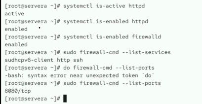
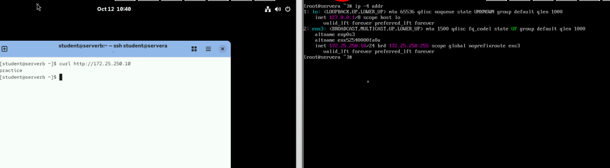
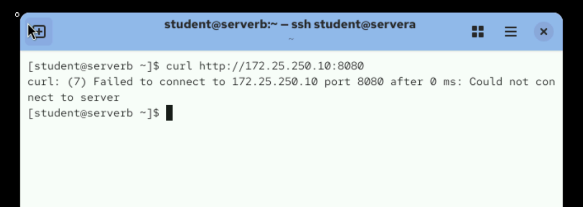
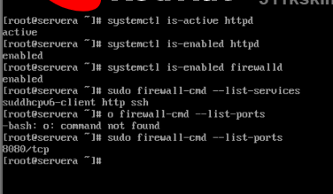
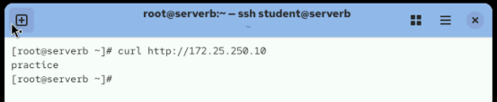

# Week 06 - Lab 01

## 실습 정보

- 발표자: 이주희
- 주제: Systemd 서비스 & 방화벽
- 유형: 실습형

---

## 문제 1

> httpd 서비스와 firewalld를 설정하고, 방화벽 규칙이 재부팅 후에도 유지되는지 확인합니다.

### 수행 결과

`httpd`와 `firewalld`가 정상적으로 활성화 및 자동 시작되도록 설정했습니다.

또한 방화벽에서 `http` 서비스를 허용하고, `8080/tcp` 포트를 추가한 뒤 `cockpit` 서비스를 제거했습니다.

다른 호스트에서 웹 서버에 접속하여 `practice`가 정상적으로 출력되는 것을 확인했습니다.

`8080/tcp` 포트가 방화벽에서 허용된 상태임을 확인했습니다.

서버 재부팅 후에도 `httpd`, `firewalld` 및 방화벽 설정이 유지되는 것을 확인했습니다.

재부팅 후 다른 호스트에서 다시 웹 서버에 접속하여 `practice`가 출력되는 것을 확인했습니다.

---

# 선택 작성

## 배운 점

> `systemctl`을 통한 서비스 자동 시작 설정과 `firewall-cmd --permanent`를 이용한 영구 방화벽 설정 방법을 확인했습니다.