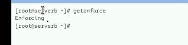
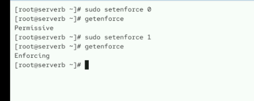
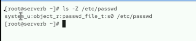
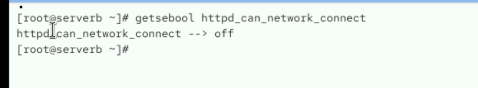

# Week 06 - Lab 02

## 실습 정보

- 발표자: 김기석
- 주제: SELinux
- 유형: 실습형

---

## 문제 1

> 현재 SELinux 모드를 확인합니다.

### 수행 결과

`getenforce` 명령으로 현재 SELinux 모드가 `Enforcing`인 것을 확인했습니다.

---

## 문제 2

> SELinux를 Permissive 모드로 변경한 뒤 다시 Enforcing 모드로 되돌립니다.

### 수행 결과

`setenforce 0`으로 `Permissive` 모드로 변경한 뒤, `setenforce 1`을 사용하여 최종 상태를 `Enforcing`으로 되돌렸습니다.

---

## 문제 3

> `/etc/passwd` 파일의 SELinux 컨텍스트를 확인합니다.

### 수행 결과

`ls -Z /etc/passwd` 명령으로 컨텍스트를 확인했습니다.

- 전체 컨텍스트: `system_u:object_r:passwd_file_t:s0`
- 타입: `passwd_file_t`

---

## 문제 4

> `httpd_can_network_connect` Boolean의 현재 값을 확인합니다.

### 수행 결과

현재 값이 `off`로 설정되어 있는 것을 확인했습니다.

---

# 선택 작성

## 배운 점

> SELinux의 운영 모드 전환 방법과 파일 컨텍스트 및 Boolean 값을 확인하는 방법을 다시 익혔습니다.